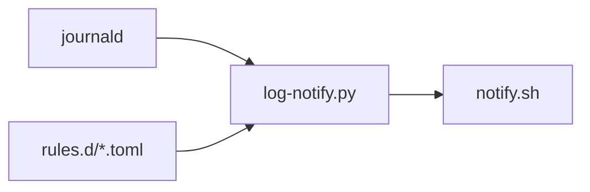

# Log Notify

宿主机常驻的 user service，跟随 user journal，命中服务声明的正则时发桌面通知。典型用途：服务没配 SMTP，登录验证码只打印在日志里。



## 部署

| 内容 | 源                               | 目标                                        |
| ---- | -------------------------------- | ------------------------------------------- |
| 脚本 | `log-notify/runtime/`            | `~/.local/lib/log-notify/`                  |
| 服务 | `log-notify/systemd/`            | `~/.config/systemd/user/log-notify.service` |
| 规则 | `<service>/log-notify/rules.d/*` | `~/.config/log-notify/rules.d/`             |

- 启用：`.dotter/local.toml` 的 `packages` 加 `log-notify`；自启动则把它加进 `autostart_services`
- 规则文件跟随**服务自己的 package** 部署：服务没启用，规则就不会生效
- 规则只在启动时加载，改动后执行 `systemctl --user restart log-notify`

## 规则格式

每个服务一个 TOML 文件，可含多条 `[[rule]]`：

```toml
[[rule]]
unit = "multica-server.service"   # 必填，只扫描该 unit 的日志
pattern = 'Verification code for (?P<who>\S+): (?P<code>\d+)'
title = "Multica 验证码"
body = "{code}  ({who})"          # 用命名分组格式化，{0} 是整段匹配
```

- 必须写 `unit`：用 `journalctl -u` 在源头过滤，正则只对这些 unit 的新日志运行
- 正则用 `search`，Python `re` 语法；TOML 里用单引号字面量，免去转义
- 只跟随新日志（`-n 0`），watcher 停机期间的事件不会补发
- 命中后只记录规则名，不记录匹配内容，因为内容可能是一次性密钥

## 通知出口

本仓库不实现通知发送，直接调用外部 dotfiles 仓库部署的 [`notify.sh`](https://github.com/specter119/dotfiles/blob/master/agent/share/cli-hooks/notify.sh)（WSL 弹 Windows 通知，Linux 走 `notify-send`）。标题通过 `NOTIFICATION_TITLE` 传入，找不到它时退回 `notify-send`。

> [!IMPORTANT]
> 依赖 [specter119/dotfiles](https://github.com/specter119/dotfiles) 的 `agent` package 把它部署到 `~/.local/share/cli-hooks/notify.sh`。通知相关的行为变更请改那边，不要在本仓库重复实现。路径可用环境变量 `LOG_NOTIFY_SH` 覆盖。

## 已接入

| 服务    | 规则                                                                                                           |
| ------- | -------------------------------------------------------------------------------------------------------------- |
| Multica | server 未配置 SMTP/Resend 时，验证码只打印为 `[DEV] Verification code for <email>: <code>`；配置后规则不再命中 |

## TODO

- Magpie：目前没有已知的需要通知的日志模式。启动日志只有带 `?k=<MAGPIE_WEB_KEY>` 的访问链接，不适合推送。发现合适的事件（如上游 key 失效）后再补 `magpie/log-notify/rules.d/magpie.toml`

## 参考

- <https://github.com/specter119/dotfiles/blob/master/agent/share/cli-hooks/notify.sh>
- <https://www.freedesktop.org/software/systemd/man/latest/journalctl.html>
- <https://docs.python.org/3/library/re.html>
