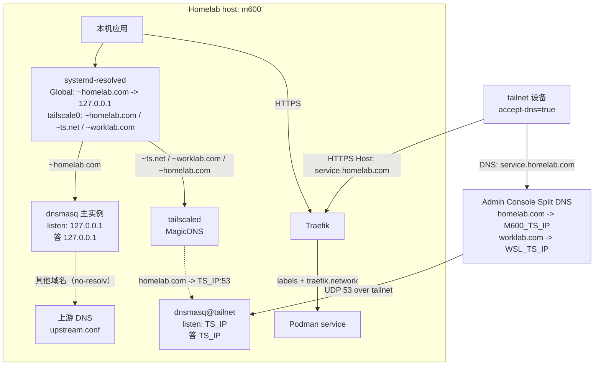
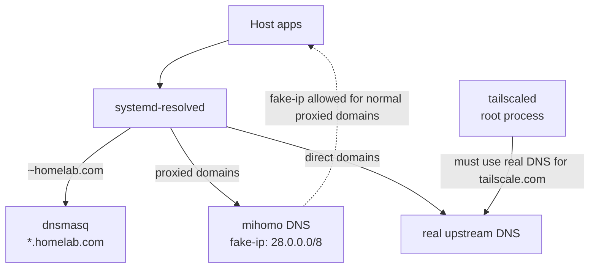

# Tailscale 远程访问配置

在 [traefik.md](traefik.md) 的本机 DNS 之上叠加 Tailscale：tailnet 设备用**相同域名**访问 homelab 服务，m600 同时消费 tailnet 下发的 Split DNS 与 MagicDNS。

## 文档分层

| 文档                                     | 内容                                                                      |
| ---------------------------------------- | ------------------------------------------------------------------------- |
| [traefik.md](traefik.md)                 | 基础层：本机 dnsmasq（Linux / WSL 两个分支），不依赖 Tailscale，单独可用  |
| 本文                                     | tailnet 层：职责划分、ACL、Split DNS、`dnsmasq@tailnet`、时序、验证、附录 |
| [tailscale-wsl.md](tailscale-wsl.md)     | 只写 WSL2 主机（`worklab.com`）相对本文的差异                             |
| [tailscale-relay.md](tailscale-relay.md) | 只写 relay-vps 的 Peer Relay                                              |

> [!IMPORTANT]
> 叠加 Tailscale 不修改基础层的任何文件：主实例的 `homelab.conf`、`upstream.conf`、resolved drop-in、NetworkManager dispatcher 都保持 [traefik.md](traefik.md) 的原样。移除 Tailscale 时只需停用 `dnsmasq@tailnet`。

## 占位符

| 占位符          | 含义                                                  |
| --------------- | ----------------------------------------------------- |
| `$TS_IP`        | 当前机器的 Tailscale IPv4，`TS_IP=$(tailscale ip -4)` |
| `<M600_TS_IP>`  | m600 的 Tailscale IP                                  |
| `<WSL_TS_IP>`   | office-wsl 的 Tailscale IP                            |
| `<tailnet>`     | tailnet 名，MagicDNS 后缀为 `<tailnet>.ts.net`        |
| `<owner-email>` | ACL `tagOwners` 里的账号邮箱                          |

`<WSL_IP>`（WSL eth0 地址）的定义见 [traefik.md](traefik.md)。

## 职责

一个 zone 只有一个 owner，避免两套配置各答一半：

| Zone          | Owner                           | 说明                                                                        |
| ------------- | ------------------------------- | --------------------------------------------------------------------------- |
| `homelab.com` | m600 的 dnsmasq                 | 本机问主实例（答 `127.0.0.1`），tailnet 问 `dnsmasq@tailnet`（答 `$TS_IP`） |
| `worklab.com` | office-wsl 的 `dnsmasq@tailnet` | 经 Admin Console Split DNS，见 [tailscale-wsl.md](tailscale-wsl.md)         |
| `*.ts.net`    | tailscaled MagicDNS             | 从 netmap 直接回答；dnsmasq 不转发                                          |
| 其他          | `upstream.conf` 里的上游 DNS    | 由 NetworkManager dispatcher 维护                                           |

| 节点       | Tag           | `accept-dns`             | 角色                                                         |
| ---------- | ------------- | ------------------------ | ------------------------------------------------------------ |
| m600       | `tag:homelab` | `true`                   | Traefik + 全部服务；主实例 + `dnsmasq@tailnet`               |
| office-wsl | `tag:homelab` | 默认                     | `worklab.com` 服务，见 [tailscale-wsl.md](tailscale-wsl.md)  |
| relay-vps  | `tag:relay`   | `false`                  | 只做 Peer Relay，见 [tailscale-relay.md](tailscale-relay.md) |
| 其他客户端 | 成员设备      | 需要 Split DNS 时 `true` | 不开就拿不到 Split DNS，只能自己写 hosts                     |

> [!NOTE]
> 不要给 relay-vps 加 `tag:homelab`，也不要给 m600 加 `tag:relay`。角色分离可以避免 ACL 权限扩散。

## 架构

以 Dozzle 为例，本机与远程使用相同 URL（`https://dozzle.homelab.com`）：



## ACL

> [!NOTE]
> 以下是节选，只列本仓库依赖的部分。

```json
{
  "tagOwners": {
    "tag:homelab": ["<owner-email>"],
    "tag:relay": ["<owner-email>"]
  },
  "grants": [
    {
      "src": ["autogroup:member"],
      "dst": ["tag:homelab"],
      "ip": ["*"]
    },
    {
      "src": ["tag:homelab"],
      "dst": ["tag:homelab"],
      "ip": ["tcp:22", "tcp:80", "tcp:443", "udp:53", "tcp:53"]
    },
    {
      "src": ["*"],
      "dst": ["tag:relay"],
      "app": { "tailscale.com/cap/relay": [] }
    },
    {
      "src": ["autogroup:member", "tag:homelab"],
      "dst": ["tag:relay"],
      "ip": ["tcp:443"]
    }
  ]
}
```

- `member → homelab`：手机、PC 访问 homelab，Split DNS 生效的前置条件
- `homelab → homelab`：homelab 节点互访。不加时两台 tagged 节点不会出现在彼此的 `tailscale status` 里，`tailscale ping` 报 `no matching peer`。`tcp:22` 用于 homelab 节点间 SSH，跨主机 DNS 需要 `udp:53`、`tcp:53`
- `* → relay`：Peer Relay 许可，见 [tailscale-relay.md](tailscale-relay.md)
- `→ relay tcp:443`：只有 relay-vps 上另外提供 tailnet 内 Serve 服务时才需要，否则可删

> [!IMPORTANT]
> ACL 必须在 `tailscale up --advertise-tags=...` **之前**保存到 [Admin Console](https://login.tailscale.com/admin/acls)，否则授权被拒。已经失败时，改完 ACL 后重新执行同一条 `up` 即可，不用 logout。

> [!TIP]
> 第一条 `ip: ["*"]` 会放行所有端口。只需要 Web 时收窄到 `tcp:80`、`tcp:443`，但跨机 DNS 仍要保留 `udp:53`、`tcp:53`，否则 Split DNS 失效。

## 配置步骤（m600）

### 1. 启动 Tailscale

```bash
sudo tailscale up --accept-dns=true --advertise-tags=tag:homelab
TS_IP=$(tailscale ip -4)
```

> [!NOTE]
> 带 flag 的 `tailscale up` 会把未写出的项按默认值处理，若因此改变现有设置就报错（除非加 `--reset`）。只改单项时用 `tailscale set`，它只动显式给出的字段：`sudo tailscale set --accept-dns=true`。

> [!IMPORTANT]
> `accept-dns=true` 让 m600 自己接收 tailnet 下发的 DNS：`worklab.com` 的 Split DNS 与 MagicDNS 的 `ts.net`。`homelab.com` 不依赖它，主实例走 `resolved -> 127.0.0.1`，tailscaled 停掉也能解析。

### 2. 起 `dnsmasq@tailnet` 实例

dnsmasq 的 `address=` 是全局配置，无法按查询来源返回不同 A 记录：本机要答 `127.0.0.1`，tailnet 设备要答 `$TS_IP`。因此基础层的主实例保持不变，另起一个只监听 `$TS_IP` 的实例。

Arch 的 dnsmasq 包没有实例模板，需要自己写 unit（Debian 自带 `dnsmasq@.service`，见 [tailscale-wsl.md](tailscale-wsl.md)）：

```bash
sudo tee /etc/systemd/system/dnsmasq@.service > /dev/null << 'EOF'
[Unit]
Description=dnsmasq instance %i
After=network.target

[Service]
ExecStartPre=/usr/bin/dnsmasq --test -C /etc/dnsmasq-%i.conf
ExecStart=/usr/bin/dnsmasq -k -C /etc/dnsmasq-%i.conf --user=dnsmasq --pid-file
ExecReload=/bin/kill -HUP $MAINPID
Restart=on-failure
PrivateDevices=true
ProtectSystem=full

[Install]
WantedBy=multi-user.target
EOF

sudo tee /etc/dnsmasq-tailnet.conf > /dev/null << EOF
listen-address=${TS_IP}
bind-dynamic
no-resolv
no-hosts
domain-needed
bogus-priv
local=/homelab.com/
address=/.homelab.com/${TS_IP}
cache-size=0
EOF

sudo systemctl daemon-reload
sudo systemctl enable --now dnsmasq@tailnet
```

> [!IMPORTANT]
>
> - 配置文件放在 `/etc/dnsmasq-tailnet.conf`，**不要**放进 `/etc/dnsmasq.d/`，否则主实例也会加载它并抢占端口。
> - 主实例的 `homelab.conf` 只监听 `127.0.0.1`，不要再加 `$TS_IP`。两个实例都不能绑 wildcard，否则后启动的实例报 `Address already in use`。
> - unit 不开 D-Bus（主实例已占用 D-Bus 名字），也不加 `User=`、`CapabilityBoundingSet=`：`bind-dynamic` 在降权后仍需要保留绑定 53 端口的能力。
> - 实例没有 `server=`，只回答 `homelab.com`，不做递归。

### 3. 配置 Split DNS（Admin Console）

1. 打开 [Admin Console DNS 页面](https://login.tailscale.com/admin/dns)
1. **Nameservers** → **Add nameserver** → **Custom**
1. 添加两条，均勾选 **Restrict to domain**（Split DNS）：
   - `homelab.com` → `<M600_TS_IP>`
   - `worklab.com` → `<WSL_TS_IP>`
1. 不要开启 **Override local DNS**：Split DNS 只定向这两个域，不接管客户端全局 DNS

`*.ts.net` 由 MagicDNS 自动回答，不需要添加 nameserver。

## 时序

- **主实例不等 tailscaled**：本机 `homelab.com` 必须在 tailscaled 未就绪时也能回答。基础层不引用 tailscaled，也没有 `Wants=`。
- **tailnet 实例靠 `bind-dynamic` 等 `$TS_IP`**：tailscaled 晚于它启动或重启，`tailscale0` 出现时它自动开始监听，不需要重启实例，也不需要 `After=tailscaled`。
- **tailscaled 不依赖 dnsmasq**：它只需要 systemd-resolved。tailscaled 重启只会短暂影响 `worklab.com` 与 `*.ts.net`。
- **本机结果可能是两个地址之一**：tailscale 在线时，resolved 对 `~homelab.com` 同时查询 Global（主实例）与 `tailscale0`（经 Split DNS 回到 tailnet 实例），取先返回的结果，所以 `resolvectl query` 可能得到 `127.0.0.1` 或 `$TS_IP`，两者都能访问 Traefik。tailscaled 不在时只剩 `127.0.0.1`。
- **耦合约束**：两种结果意味着 Traefik 会看到两种来源地址，`traefik.trusted_source_ranges` 必须同时包含 `127.0.0.1/32` 和 `100.64.0.0/10`（见 [traefik.md](traefik.md#%E5%85%B1%E4%BA%AB%E4%B8%AD%E9%97%B4%E4%BB%B6)）。
- **`$TS_IP` 变化**：节点删除重建后 IP 会变，需要更新 `/etc/dnsmasq-tailnet.conf` 与 Admin Console 的路由。

> [!NOTE]
> dnsmasq 上游的维护方式属于基础层，见 [traefik.md](traefik.md)；容器的外部解析见 [quadlet.md](quadlet.md#%E7%BD%91%E7%BB%9C%E6%9E%B6%E6%9E%84)。

## 验证与排障

```bash
# 1. 两个监听、两个进程都在
ss -ulnH 'sport = :53'          # 127.0.0.1:53 与 $TS_IP:53
systemctl is-active dnsmasq dnsmasq@tailnet

# 2. 两个实例各答各的
dig +short @127.0.0.1 dozzle.homelab.com   # 127.0.0.1
dig +short @$TS_IP dozzle.homelab.com      # $TS_IP
dig @$TS_IP example.com | grep status      # REFUSED：tailnet 实例不做递归

# 3. 系统解析链
resolvectl query dozzle.homelab.com          # 127.0.0.1 或 $TS_IP 都正常，见「时序」
resolvectl query relay-vps.<tailnet>.ts.net  # link: tailscale0

# 4. Tailscale 状态
tailscale status                           # 末尾不应有 resolved-nm 的 Health check

# 5. Traefik 的两条来源路径都不能是 403
for ip in 127.0.0.1 $TS_IP; do
  curl -sk -o /dev/null -w '%{http_code}\n' \
    --resolve traefik.homelab.com:443:$ip https://traefik.homelab.com/
done
```

远程设备（需已连接 Tailscale 且 `accept-dns=true`）：

```bash
dig @$TS_IP dozzle.homelab.com +short      # 应返回 $TS_IP
```

| 现象                                                                  | 处理                                                                                                                    |
| --------------------------------------------------------------------- | ----------------------------------------------------------------------------------------------------------------------- |
| `tailscale status` 有 `resolved-nm` 告警                              | `/etc/resolv.conf` 不是指向 resolved stub 的 symlink，按 [traefik.md](traefik.md) 第 1 步修复，再重启 tailscaled        |
| 只有 `127.0.0.1:53`，没有 `$TS_IP:53`                                 | 看 `systemctl status dnsmasq@tailnet`，确认 `tailscale0` 已有地址、`listen-address` 与当前 `$TS_IP` 一致                |
| `dnsmasq@tailnet` 报 `Address already in use`                         | 另一个实例绑了 wildcard 或加载了同一份配置，检查 `homelab.conf` 与 conf-dir                                             |
| 远程设备解析失败                                                      | `tailscale status` 确认连通，再 `dig @$TS_IP dozzle.homelab.com`                                                        |
| Split DNS 未生效                                                      | 确认 Admin Console 已保存，然后重连客户端（桌面端重开 Tailscale，Linux `systemctl restart tailscaled`，移动端断开重连） |
| `worklab.com` 解析慢，或出现 `can't reach the configured DNS servers` | office-wsl 离线或全部走 DERP，不是本机配置问题，见 [tailscale-wsl.md](tailscale-wsl.md)                                 |

## 离线行为

| 场景                       | 结果                                                                        |
| -------------------------- | --------------------------------------------------------------------------- |
| m600 本机，tailscaled 停止 | `homelab.com` 可用（只剩 `127.0.0.1` 路径）；`ts.net`、`worklab.com` 不可用 |
| m600 本机，外网断开        | `homelab.com` 可用，不碰网络                                                |
| 同 LAN 的 tailnet 设备     | 可用：WireGuard 直连仍在，`$TS_IP:53` 可达                                  |
| 跨网设备                   | 需要外网或 DERP，本来就要外网才可达                                         |

## 附录：FlClash 与 Tailscale 共存

Android 上同时使用 FlClash 和 Tailscale 时，在 FlClash 中配置域名服务器策略：

**工具** → **基本配置** → **DNS** → **域名服务器策略** → 新建：

- 域名：`+.homelab.com`
- 服务器：`<M600_TS_IP>`

## 附录：Linux mihomo（Clash.Meta）与 Tailscale 共存

Linux 上若启用 mihomo TUN + `enhanced-mode: fake-ip`，**必须**把 Tailscale 相关后缀同时加入 DNS 旁路与直连规则。只做直连规则不够：域名仍会分到 fake-ip（`28.0.0.0/8`），而 `tailscaled` 以 root 运行、不在 mihomo 的 per-uid 隧道里，会表现为 `NoState` / `controlplane.tailscale.com` register `context deadline exceeded`。



- `mihomo` 可以给普通代理域名返回 fake-ip，但 Tailscale 控制面域名必须走真实解析和直连。
- mihomo 不替代 dnsmasq：`*.homelab.com` 由 dnsmasq 回答，mihomo 只处理代理 DNS 与分流。
- Podman 自定义 bridge 的容器 DNS 见 [quadlet.md](quadlet.md#%E7%BD%91%E7%BB%9C%E6%9E%B6%E6%9E%84)。

本仓库不管理 mihomo，只记录 Tailscale 控制面需要真实 DNS 与直连这一边界。mihomo 侧的必要 pattern：

```yaml
dns:
  enhanced-mode: fake-ip
  fake-ip-range: 28.0.0.1/8
  fake-ip-filter:
    - +.tailscale.com
    - +.tailscale.io

rules:
  - DOMAIN-SUFFIX,tailscale.com,直连,no-resolve
  - DOMAIN-SUFFIX,tailscale.io,直连,no-resolve
```

> [!IMPORTANT]
> 两层都要：
>
> 1. `fake-ip-filter`：DNS 不返回 `28.x` fake-ip
> 1. `DOMAIN-SUFFIX,...,直连`：流量不进代理
>
> 不要用 `hosts:` 写死 controlplane IP；filter 只是“走真实解析”，不是静态 hosts。

修改后重启或重载 mihomo，并清空 fake-ip 缓存。验证：

```bash
# 应返回非 28.x（真实解析；若上游污染可能是 192.200.0.x，仍不是 fake-ip）
dig @127.0.0.1 -p 1053 controlplane.tailscale.com +short
dig @127.0.0.1 -p 1053 derp.tailscale.com +short

# 对照：普通被代理域名仍应是 fake-ip
dig @127.0.0.1 -p 1053 www.google.com +short

# Tailscale 应 Running，且 peer 可达
tailscale status
```

## 安全注意事项

- **tailnet 实例不递归**：`dnsmasq@tailnet` 只回答 `homelab.com`，没有上游。主实例只监听 `127.0.0.1`，不对 tailnet 暴露递归。
- **不开 Override local DNS**：`homelab.com` 只经 Split DNS 定向到 m600，不接管客户端全局 DNS。

## 参考

> [!IMPORTANT]
> 修改本文档前，先查阅以下官方链接验证配置是否过时。

- [Tailscale Split DNS](https://tailscale.com/kb/1054/dns)
- [Split DNS Policies](https://tailscale.com/kb/1588/split-dns-policies)
- [MagicDNS](https://tailscale.com/kb/1081/magicdns)
- [Linux DNS 配置](https://tailscale.com/docs/reference/linux-dns)
- [tailscaled(8)](https://man.archlinux.org/man/tailscaled.8.en)
- [dnsmasq(8)](https://man.archlinux.org/man/dnsmasq.8.en)
- [systemd-resolved(8)](https://man.archlinux.org/man/systemd-resolved.8.en)
- [mihomo DNS / fake-ip](https://wiki.metacubex.one/config/dns/)
